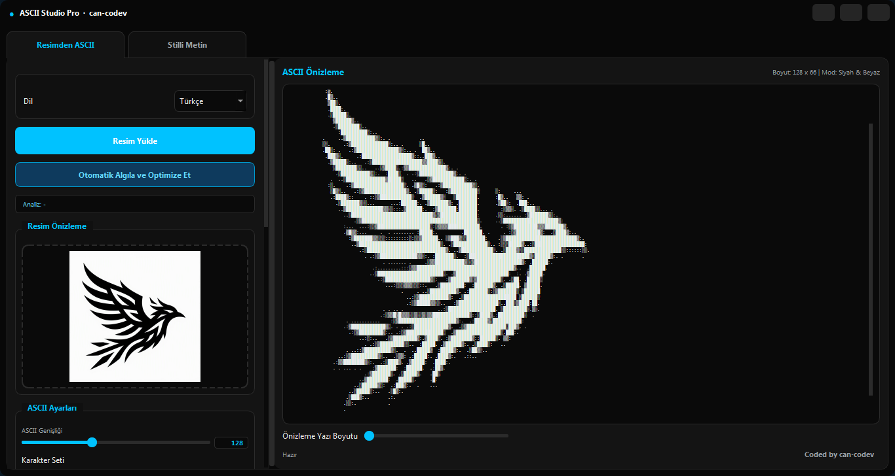
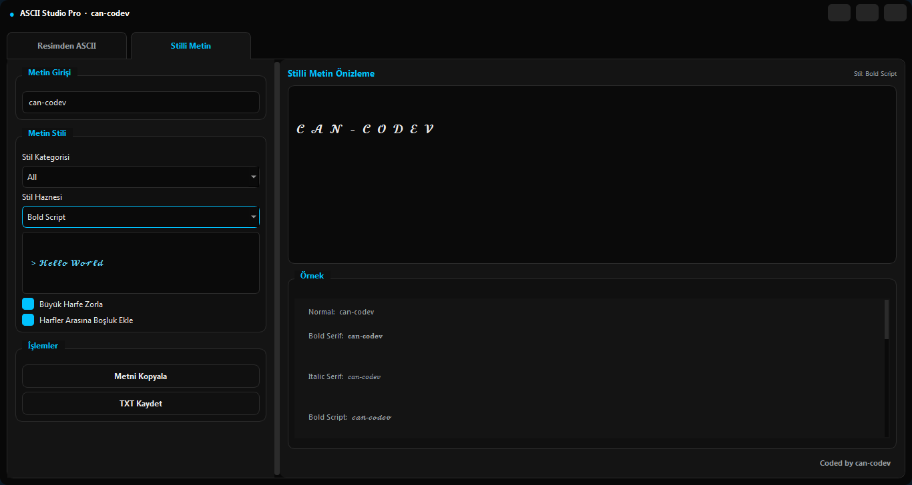

<div align="center">
  <h1>Can-Codev ASCII Studio</h1>

  <p>
    <strong>Turn images into ASCII art and transform text with creative Unicode styles.</strong>
    <br>
    <strong>Görselleri ASCII sanatına dönüştürün, metinlerinize yaratıcı Unicode stilleri uygulayın.</strong>
  </p>

  <p>
    
    
    
    
    
  </p>

</div>

---

<table align="center">
  <tr>
    <td align="center">
      
      <br>
      <sub>Image to ASCII</sub>
    </td>
    <td align="center">
      
      <br>
      <sub>Stylized Text</sub>
    </td>
  </tr>
</table>

---

<a id="english"></a>
## English

**Can-Codev ASCII Studio** is a desktop application built with Python and PyQt5. Convert images into ASCII art, customize the output, or give your text a new look with Unicode styles—all through a dark, bilingual interface.

### Features

#### Image to ASCII

- Load images using the file picker or drag and drop.
- Supports PNG, JPG/JPEG, BMP, GIF, and WebP.
- Choose from built-in character sets or create a custom character set.
- Preview ASCII output in black and white or color.
- Adjust ASCII width, contrast, brightness, gamma, sharpness, and edge strength.
- Choose a dithering method: **Off**, **Ordered Bayer**, or **Floyd–Steinberg**.
- Automatically analyze an image and apply recommended settings.
- Control how transparent areas appear: keep them empty, use dots, or blend them with a chosen background color.
- Copy the output or save it as a TXT file, HTML file, or PNG preview.
- Process conversions in a background thread to keep the interface responsive.

#### Stylized Text

- Explore Unicode fonts, symbols, combining marks, decorators, and frames.
- Convert text to Morse code, binary, leet speak, upside-down text, or mirrored text.
- Browse styles by category and preview the selected style.
- Force uppercase or add spaces between characters.
- Copy the result or save it as a TXT file.

#### Interface

- Switch between English and Turkish.
- Use a dark interface with cyan accents.

### Requirements

- Python 3.9–3.11 recommended.
- `pip`
- Dependencies listed in `requirements.txt`: PyQt5, NumPy, and Pillow.

### Installation

Clone or download the repository:

```bash
git clone https://github.com/can-codev/ascii-studio.git
cd ascii-studio
python -m venv .venv
```

Activate the virtual environment and install the dependencies.

**Windows — PowerShell**

```powershell
.\.venv\Scripts\Activate.ps1
python -m pip install -r requirements.txt
```

**macOS / Linux**

```bash
source .venv/bin/activate
python -m pip install -r requirements.txt
```

### Run

```bash
python ascii_studio.py
```

On some macOS or Linux systems, use `python3 ascii_studio.py`. If your Python file has a different name, replace `ascii_studio.py` with that filename.

### How to Use

**Image to ASCII**

1. Open the **Image to ASCII** tab.
2. Select an image or drag and drop it into the application.
3. Adjust the character set and image settings, or click **Auto-Detect and Optimize**.
4. Copy the result or save it as TXT, HTML, or PNG.

**Stylized Text**

1. Open the **Stylized Text** tab and enter your text.
2. Choose a style category and a style preset.
3. Optionally enable uppercase or add spaces between characters.
4. Preview, copy, or save the result.

### Notes

- Images are processed locally and are not uploaded to an external service.
- Copied output and TXT files contain plain text. HTML and PNG exports can preserve character colors.
- Unicode characters may look different depending on the operating system and font.
- Very large image outputs may be automatically reduced to keep processing manageable.
- The source uses Pillow’s legacy `Image.BILINEAR` and `Image.LANCZOS` constants, so `requirements.txt` limits Pillow to versions below 10. To use Pillow 10 or newer, update these constants to `Image.Resampling.BILINEAR` and `Image.Resampling.LANCZOS`.

---

<a id="turkce"></a>
## Türkçe

**Can-Codev ASCII Studio**, Python ve PyQt5 ile geliştirilmiş bir masaüstü uygulamasıdır. Görselleri ASCII sanatına dönüştürebilir, çıktıyı özelleştirebilir veya Unicode stilleriyle metinlerinize farklı bir görünüm kazandırabilirsiniz. Uygulama koyu temalı ve iki dilli bir arayüze sahiptir.

### Özellikler

#### Resimden ASCII

- Dosya seçiciyle veya sürükleyip bırakarak görsel yükleme.
- PNG, JPG/JPEG, BMP, GIF ve WebP desteği.
- Hazır karakter setleri arasından seçim yapma veya özel karakter seti oluşturma.
- ASCII çıktısını siyah-beyaz ya da renkli görüntüleme.
- ASCII genişliği, kontrast, parlaklık, gamma, keskinlik ve kenar belirginliği ayarları.
- **Kapalı**, **Ordered Bayer** ve **Floyd–Steinberg** dithering seçenekleri.
- Görseli analiz ederek önerilen ayarları otomatik uygulama.
- Şeffaf alanları boş bırakma, noktayla gösterme veya seçilen arka plan rengiyle birleştirme.
- Çıktıyı kopyalama ya da TXT, HTML ve PNG olarak kaydetme.
- Arayüzün yanıt vermeye devam etmesi için dönüştürme işlemlerini arka planda yürütme.

#### Stilli Metin

- Unicode yazı tiplerini, sembolleri, birleştirici işaretleri, süslemeleri ve çerçeveleri kullanma.
- Metni Morse koduna, binary’ye, leet speak’e, ters çevrilmiş veya aynalanmış yazıya dönüştürme.
- Stilleri kategorilere göre inceleme ve seçilen stili önizleme.
- Metni büyük harfe çevirme veya karakterler arasına boşluk ekleme.
- Sonucu kopyalama ya da TXT dosyası olarak kaydetme.

#### Arayüz

- Türkçe ve İngilizce arasında geçiş yapma.
- Mavi vurgulara sahip koyu temalı arayüz.

### Gereksinimler

- Python 3.9–3.11 önerilir.
- `pip`
- `requirements.txt` dosyasında listelenen PyQt5, NumPy ve Pillow paketleri.

### Kurulum

Depoyu klonlayın veya indirin:

```bash
git clone https://github.com/can-codev/ascii-studio.git
cd ascii-studio
python -m venv .venv
```

Sanal ortamı etkinleştirin ve gerekli paketleri yükleyin.

**Windows — PowerShell**

```powershell
.\.venv\Scripts\Activate.ps1
python -m pip install -r requirements.txt
```

**macOS / Linux**

```bash
source .venv/bin/activate
python -m pip install -r requirements.txt
```

### Çalıştırma

```bash
python ascii_studio.py
```

Bazı macOS veya Linux sistemlerinde `python` yerine `python3` kullanmanız gerekebilir. Python dosyanızın adı farklıysa `ascii_studio.py` kısmını kendi dosya adınızla değiştirin.

### Nasıl Kullanılır?

**Resimden ASCII**

1. **Resimden ASCII** sekmesini açın.
2. Bir görsel seçin veya görseli uygulamaya sürükleyip bırakın.
3. Karakter setini ve görsel ayarlarını düzenleyin ya da **Otomatik Algıla ve Optimize Et** seçeneğini kullanın.
4. Çıktıyı kopyalayın veya TXT, HTML ya da PNG olarak kaydedin.

**Stilli Metin**

1. **Stilli Metin** sekmesini açıp metninizi girin.
2. Bir stil kategorisi ve stil seçin.
3. İsterseniz büyük harf veya karakterler arasına boşluk seçeneklerini etkinleştirin.
4. Sonucu önizleyin, kopyalayın veya kaydedin.

### Notlar

- Görseller yerel olarak işlenir ve harici bir servise yüklenmez.
- Kopyalanan çıktı ve TXT dosyaları düz metindir. HTML ve PNG çıktıları karakter renklerini koruyabilir.
- Unicode karakterlerin görünümü işletim sistemine ve kullanılan yazı tipine göre değişebilir.
- Çok büyük görsel çıktıları, işlemin yönetilebilir kalması için otomatik olarak küçültülebilir.
- Kaynak kodda Pillow’ın eski `Image.BILINEAR` ve `Image.LANCZOS` sabitleri kullanıldığı için `requirements.txt` Pillow sürümünü 10’un altında tutar. Pillow 10 veya daha yeni bir sürüme geçmek için bu sabitleri `Image.Resampling.BILINEAR` ve `Image.Resampling.LANCZOS` olarak güncelleyin.

---

<div align="center">
  <h2>Author / Yapımcı</h2>
  <strong>Can-Codev</strong>
  <br>
  <a href="https://github.com/can-codev">GitHub</a>
</div>
